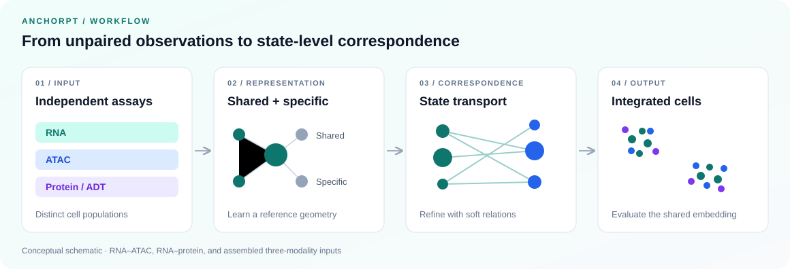

<div align="center">

# AnchorPT

### Biological States as Correspondence Primitives<br>for Unpaired Single-Cell Multi-Omics Integration

State-level population transport for cross-modal correspondence.

[](LICENSE)
[](requirements.txt)
[](docs/preprocessing.md)

**[Get started](docs/quickstart.md)** · **[Installation](docs/installation.md)** · **[Data preparation](docs/preprocessing.md)** · **[Configuration](docs/configuration.md)** · **[Reproducibility](docs/reproducibility.md)**

</div>

<br>



## Overview

AnchorPT studies correspondence between biological populations in **unpaired single-cell multi-omics data**. It learns shared and modality-specific representations, summarizes populations through soft state assignments, and refines the shared representation using transport between state anchors.

The code release includes preprocessing, two-stage training, and embedding evaluation for RNA–ATAC and RNA–protein workflows, together with an extended runner for two or three modalities.

- **Population-level correspondence.** State anchors provide an intermediate resolution between individual cells and whole-assay distributions.
- **Shared and specific factors.** Separate latent factors represent common cellular organization and modality-specific variation.
- **Transport-guided refinement.** Soft correspondence targets refine the representation while preserving its reference geometry.
- **Recorded run settings.** Training exports the integrated AnnData object, effective parameters, and a method-role manifest.

## Start with your data

| Your input | Preparation | Training entry point |
| :--- | :--- | :--- |
| RNA and ATAC count matrices | [Matrix Market + GTF or gene–region mapping](docs/preprocessing.md#rnaatac-from-matrix-market) | `src/main_anchorpt.py` |
| RNA and ATAC AnnData files | [AnnData + GTF](docs/preprocessing.md#rnaatac-from-anndata) | `src/main_anchorpt.py` |
| RNA and protein AnnData files | [HGNC-based feature mapping](docs/preprocessing.md#rnaprotein) | `src_rna_adt_three_omics/main_anchorpt.py` |
| An assembled three-modality AnnData object | [Input contract and feature masks](docs/preprocessing.md#training-input-contract) | `src_rna_adt_three_omics/main_anchorpt.py` |

**First run:** follow the [RNA–ATAC quickstart](docs/quickstart.md) from preprocessing through evaluation. Commands use Bash and run from the repository root. The pinned dependency file targets CUDA 12.1 PyTorch; see the [installation notes](docs/installation.md).

## What a run produces

| Artifact | Purpose |
| :--- | :--- |
| `result.h5ad` | Input annotations and learned embeddings |
| `obsm["latent_shared"]` | Primary integration embedding |
| `obsm["latent_specific"]` | Modality-specific latent factors |
| `params.json` | Effective model, optimization, input, and seed settings |
| `params_method_manifest.json` | Embedding roles and training supervision settings |
| `metrics.tsv` | Evaluation scores, when the evaluator is run |

The examples use these filenames; output paths are configurable. Diagnostic embeddings and benchmark aggregation are explained in the [reproducibility guide](docs/reproducibility.md).

## Repository map

```text
anchorpt-multiomics/
├── README.md
├── LICENSE
├── requirements.txt
├── docs/
│   ├── installation.md
│   ├── quickstart.md
│   ├── preprocessing.md
│   ├── configuration.md
│   ├── reproducibility.md
│   └── assets/overview.svg
├── pre_data/                       # Input preparation and unpaired splitting
├── src/                            # RNA–ATAC workflow
│   ├── main_anchorpt.py
│   ├── evaluate_metrics.py
│   └── anchorpt/                   # Model, objectives, training, and runner
└── src_rna_adt_three_omics/          # Extended two-/three-modality workflow
    ├── main_anchorpt.py
    ├── evaluate_metrics.py
    └── anchorpt/
```

The two source trees retain their original entry points. Select the runner explicitly as described in [configuration](docs/configuration.md#selecting-the-runner).

## Reproducing experiments

This repository contains source code and preprocessing utilities; benchmark datasets, annotation files, checkpoints, and numerical result tables are not bundled.

The [reproducibility guide](docs/reproducibility.md) records the current code defaults, output conventions, and evaluation protocol. Both training entry points default to **80 refinement epochs**, matching the current manuscript. Exact manuscript reproduction also requires the corresponding dataset splits and experiment configurations.

## Questions and contributions

For installation problems or reproducibility questions, [open an issue](https://github.com/yangongjiyu805-arch/anchorpt-multiomics/issues). Include the commit, runner, effective configuration, environment, and traceback. See [CONTRIBUTING.md](CONTRIBUTING.md) for a concise reporting checklist.

## License

Code is released under the [MIT License](LICENSE). Obtain datasets and reference annotations from their respective providers under their applicable terms.
